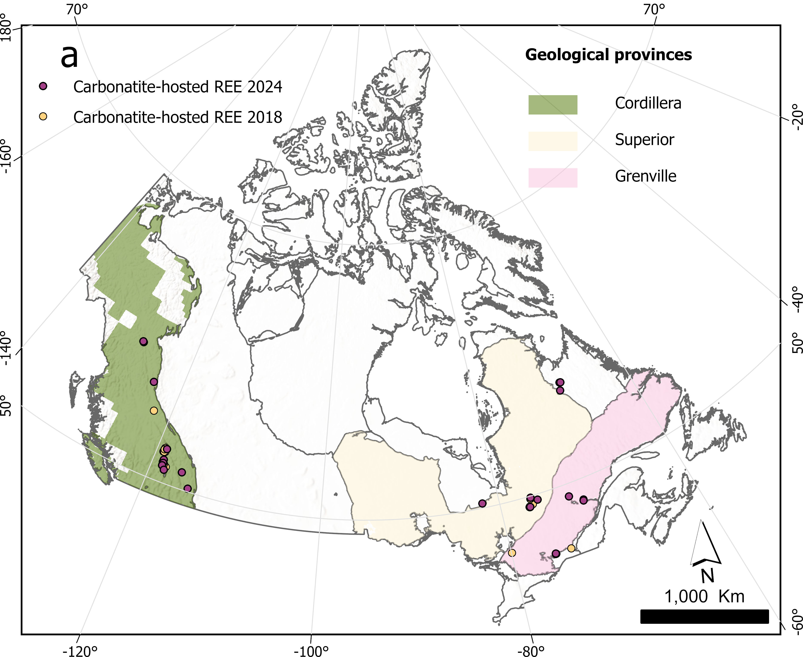
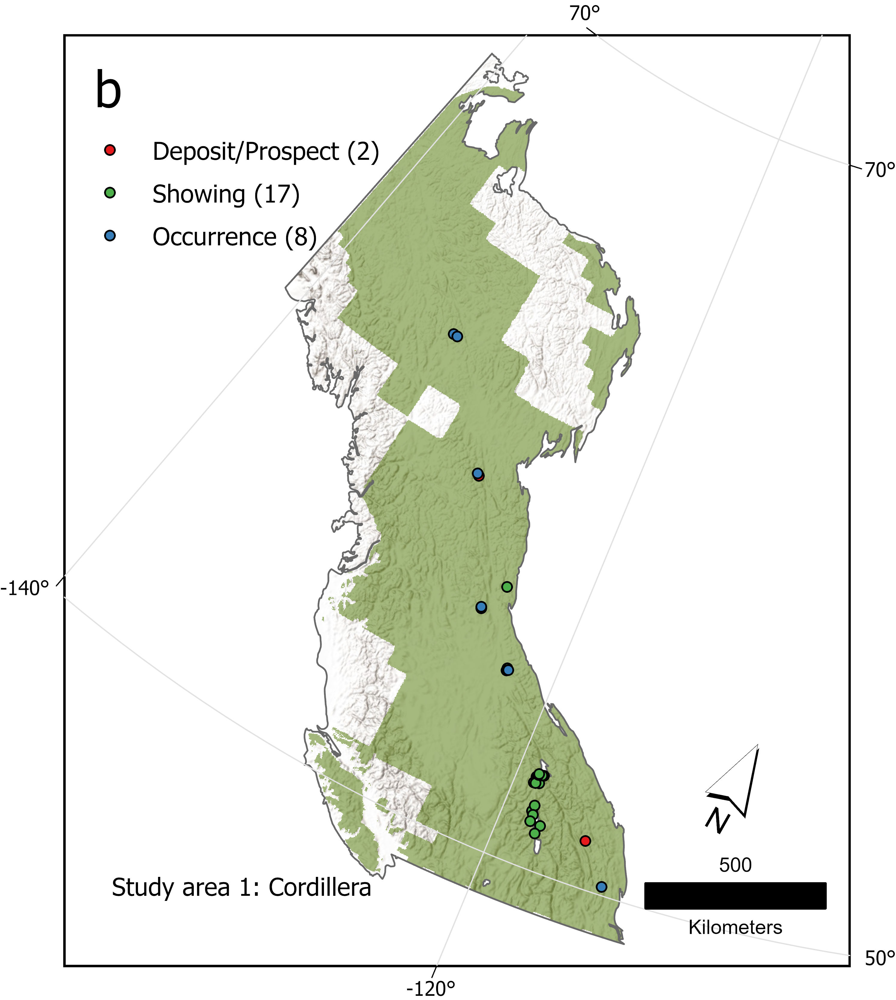
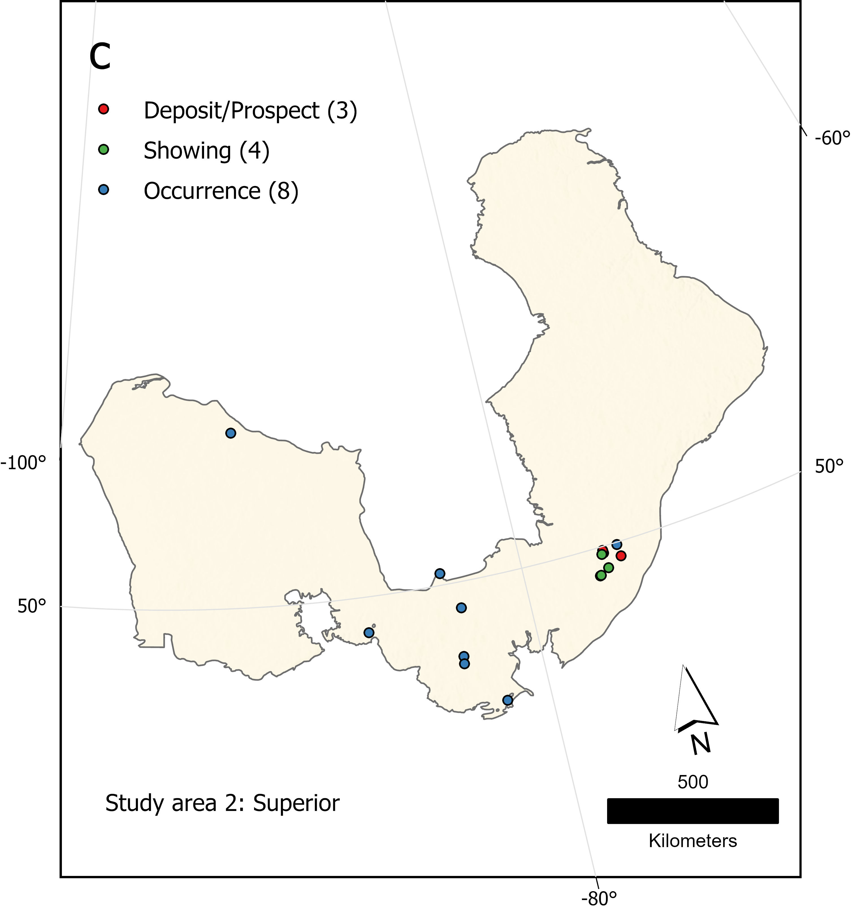
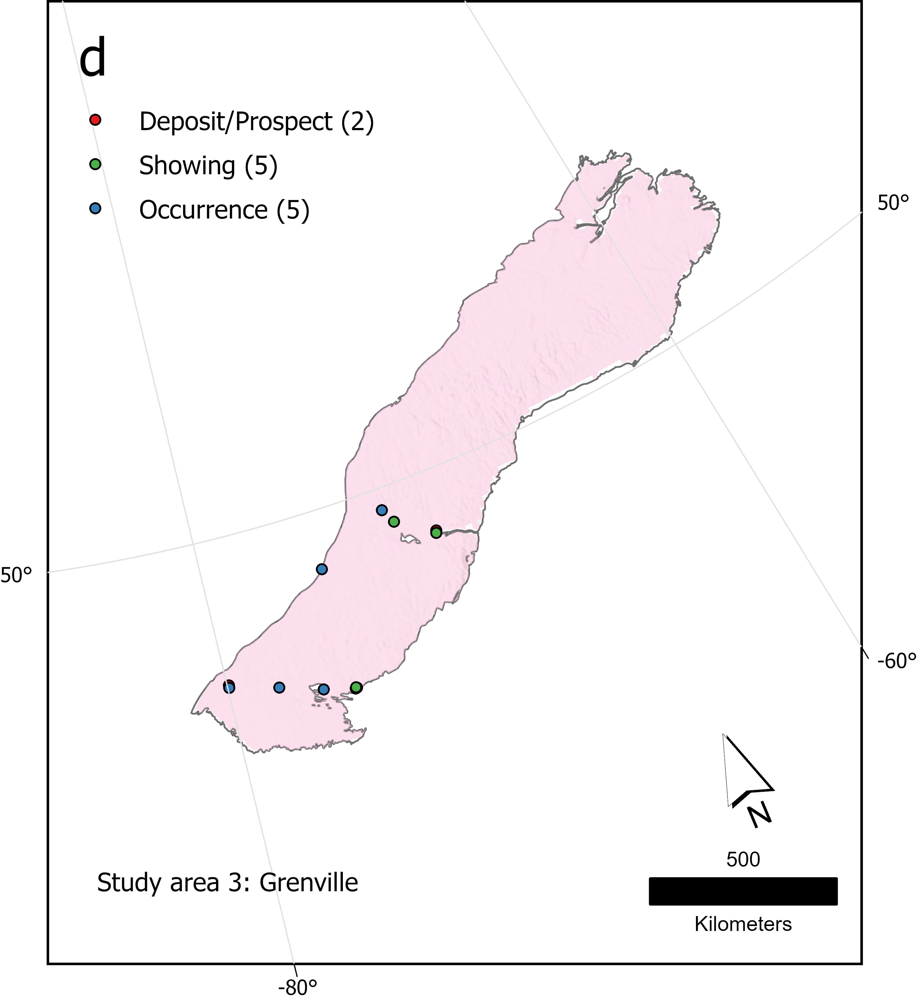
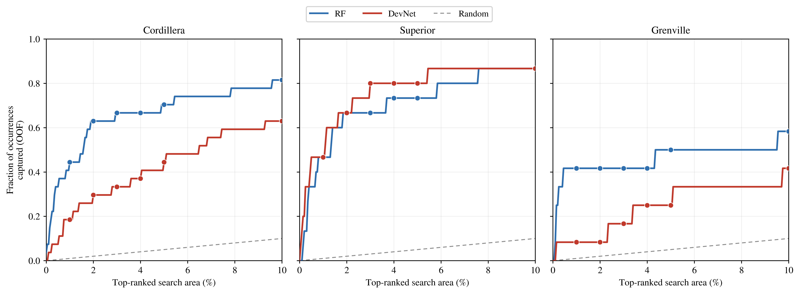
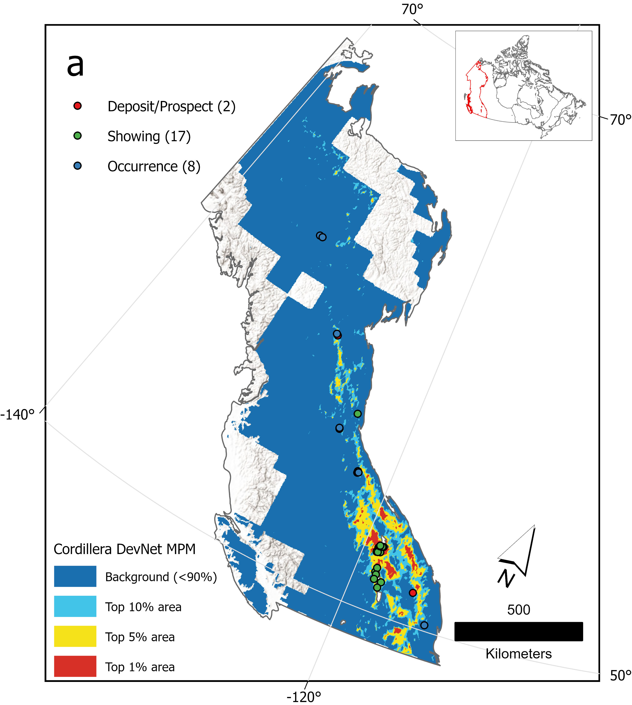
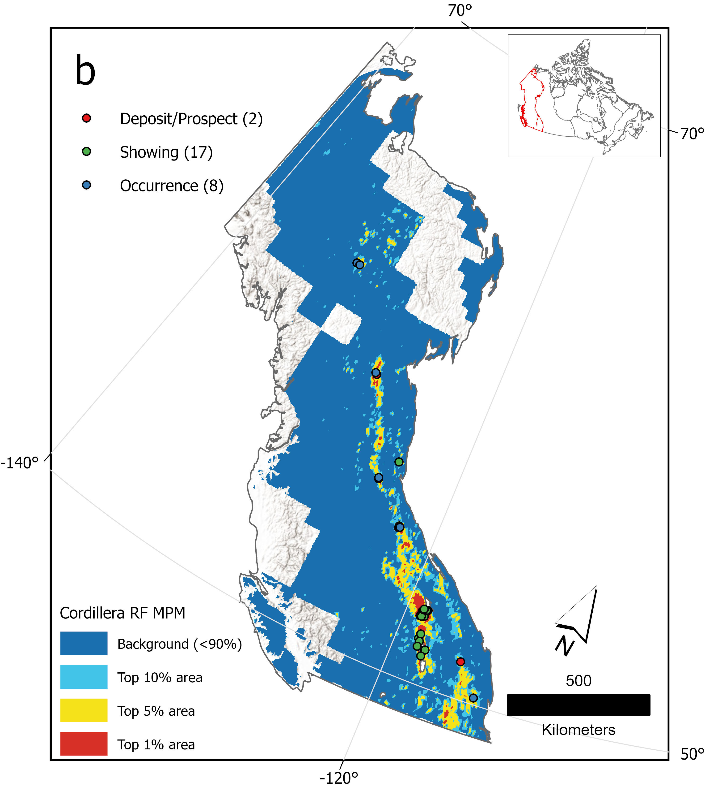
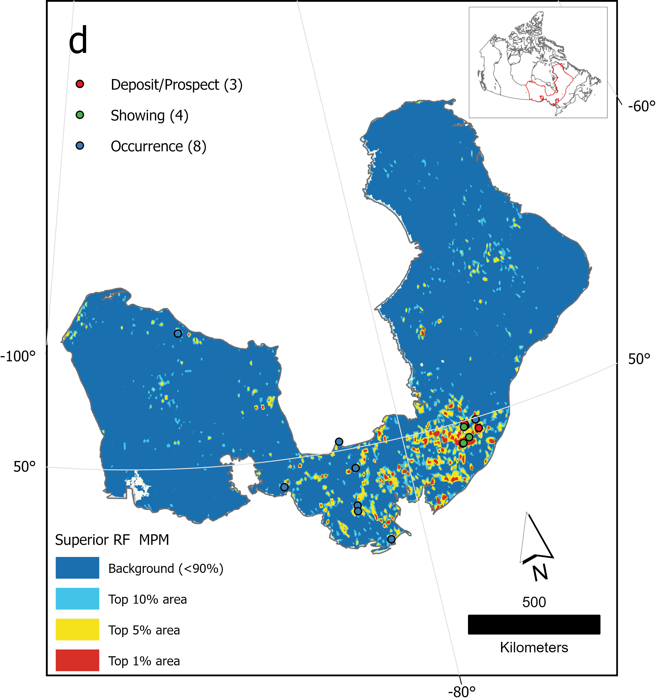
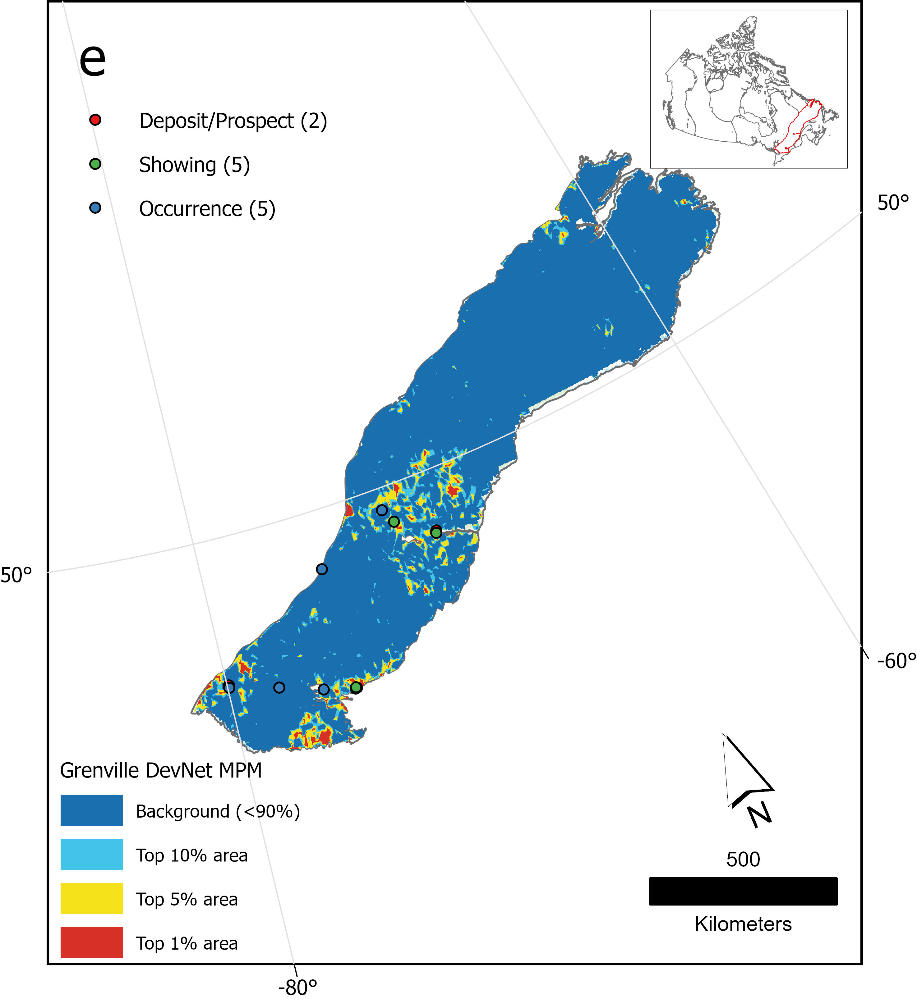

# Regional REE Prospectivity Mapping in Canada: Semi-Supervised DevNet vs. Random Forest

Code, data pointers and the full experimental record for mapping
carbonatite-hosted rare earth element (REE) prospectivity in three Canadian
geological provinces — the Cordilleran Orogen and the Superior and
Grenville provinces — with a semi-supervised deviation network (**DevNet**)
benchmarked against a **Random Forest (RF)** under one leakage-controlled
protocol, with SHAP-based interpretation and a suite of robustness
ablations.

Known carbonatite-hosted occurrences are scarce (27, 15 and 12 per region
after deduplication) and there are no confirmed barren sites. DevNet treats
the background as *unlabelled* rather than negative; RF treats the same
background points as label 0. Both models see identical points and folds,
so the learning paradigm is the only difference between them.

## Repository layout

| Path | Contents |
|---|---|
| [`notebooks/end_to_end_notebook.ipynb`](notebooks/end_to_end_notebook.ipynb) | **Start here.** Runs the whole pipeline top to bottom and reproduces every reported figure and table; stored outputs included. |
| [`src/`](src/) | The same pipeline as an importable library of composable stages (module map below). |
| [`experiments/`](experiments/) | Every notebook run during the project — abandoned directions and failed attempts included — with their outputs and a [chronological log](experiments/README.md) of what each tested and found. |
| [`data/`](data/) | Positive-label tables and study-area outlines, plus the [data guide](data/README.md): every input layer with its source, DOI and where to put it. |
| [`figures/`](figures/) | Result figures shown below. |
| [`dev/`](dev/) | Superseded code removed from the pipeline, kept with the reason it was removed. |

## Quick start

**1. Environment** (verified on Python 3.11.6; `requirements.txt` is a
freeze of the environment that produced the stored outputs):

```bash
conda create -n mpm_env python=3.11.6
conda activate mpm_env
pip install -r requirements.txt
python -m ipykernel install --user --name mpm_env --display-name "Python (mpm_env)"
```

**2. Data.** Download the layers listed in [`data/README.md`](data/README.md)
into a `dataset/` folder next to this repository, then:

```bash
mkdir -p ../dataset/outlines
cp data/outlines/*.geojson ../dataset/outlines/
cp data/labels/*_REE_deposits_deduped_2.0km.csv .
```

Eleven of the seventeen rasters are proprietary Getech products and are not
distributed; see [§2.2 of the data guide](data/README.md#22-proprietary-layers-getech).

**3. Run** (headless; `cd notebooks` matters, every path is relative to it):

```bash
cd notebooks
jupyter nbconvert --to notebook --execute end_to_end_notebook.ipynb \
    --output run_output.ipynb --ExecutePreprocessor.timeout=-1
```

The shipped notebook keeps its stored outputs; the fresh run is written to
`run_output.ipynb`. Peak memory is about 6 GB (16 GB RAM is comfortable).
One region with reduced settings (`FAST_MODE`: 1 CV repeat, 1 DevNet restart)
takes about 7 minutes; the full run (3 regions, 6 CV repeats × 5 restarts ×
300 epochs, plus ablations, SHAP, maps and GIS export) takes hours. Seeds,
fold splits and the GLCM raster choice are fixed, so a re-run reproduces
the reported figures, tables and conclusions; bit-for-bit agreement across
machines is not promised (BLAS threading and the PyTorch build move the last
digits).

**GDAL/PROJ troubleshooting.** If any `.to_crs(...)` call fails with
`CRSError: Invalid projection: EPSG:4326 ... no database context specified`,
the interpreter is reading another environment's PROJ database. Check that
`python -c "import sys; print(sys.executable)"` points into `mpm_env`, and
if running outside the Jupyter kernel created above, run
`export PROJ_DATA=$(python -c "import pyproj; print(pyproj.datadir.get_data_dir())")`.

## Results at a glance

### Study areas and known occurrences



| Cordillera | Superior | Grenville |
|---|---|---|
|  |  |  |

### Per-region performance

Pooled out-of-fold AUC and average precision (AP), repeated stratified
cross-validation (5 folds × 6 repeats), full and collinearity-pruned feature
sets.

| Region | Positives | AP DevNet (full) | AP DevNet (pruned) | AP RF (full) | AP RF (pruned) | AUC DevNet (full) | AUC DevNet (pruned) | AUC RF (full) | AUC RF (pruned) |
|---|---|---|---|---|---|---|---|---|---|
| Cordillera | 27 | 0.092 | 0.095 | 0.311 | **0.393** | 0.874 | 0.875 | 0.897 | **0.918** |
| Superior | 15 | **0.411** | 0.332 | 0.210 | 0.202 | 0.963 | 0.955 | 0.926 | **0.968** |
| Grenville | 12 | 0.050 | 0.028 | 0.123 | **0.223** | 0.678 | 0.625 | 0.750 | **0.835** |

Which model wins depends on the region and the metric. RF leads where
positives are comparatively plentiful (Cordillera). In the more label-scarce
Superior the two match on AUC while DevNet exceeds RF on AP, the metric that
matters for delineating a small, high-favourability search area. In
Grenville both models score low with wide intervals, which points at the
data signal rather than at either model.

### Capture-rate curves

Fraction of known occurrences recovered within the top-ranked fraction of
the labelled pool (a proxy for search area), from pooled out-of-fold scores,
shown up to the top 10%.



### Prospectivity maps

Classes are percentiles of each model's score (top 1%, 5%, 10%), so shading
is relative rank within a map; DevNet's anomaly score and RF's probability
are not on a common scale. Known occurrences are overlaid.

| | DevNet | Random Forest |
|---|---|---|
| **Cordillera** |  |  |
| **Superior** |  |  |
| **Grenville** |  |  |

## How the method got here

The final design is the seventh version of the model. Along the way the project
abandoned geochemical features (too sparse to give a value at every map
cell), kept alkaline-hosted occurrences out of the positive class (they are
geophysically distinct), found that cosine-selected negatives made the task
artificially easy, switched DevNet from discriminative to semi-supervised
training, merged and deduplicated two occurrence compilations, failed to
improve DevNet by tuning, and showed with an ablation that removing the
deposit buffer and deduplication inflates every metric. Each step, with its
numbers and its notebook, is in [`experiments/README.md`](experiments/README.md).

## Pipeline reference

### Run order

The notebook's header cell maps every section to its `src/` module. In
order:

0. **Data discovery** — scan the raster/vector/point roots and the
   outline/H3-grid/deposit roots; the region set is discovered, not
   hand-listed (`src/features/data_discovery.py`).
1. **Configuration** — paths, hyperparameters, `FAST_MODE`.
2. **Preprocess** — buffer-then-clip national rasters and the H3 grid to each
   study area (`src/features/raster_preprocessing.py`).
3. **Sampling and features** — positives and candidates inside the A∧B
   sampleable domain, line/point proximity, raster sampling, GLCM textures,
   terrane attributes (`src/features/`).
4. **Region feature tables** — shared training and evaluation background
   pools (`src/features/build_region.py`).
5. **Collinearity pruning**, unsupervised (`src/features/collinearity.py`).
6. **Evaluation protocol** — pooled out-of-fold, repeated CV
   (`src/evaluation/cv_protocol.py`).
7. **Random Forest** (`src/models/random_forest.py`) and
8. **DevNet** (`src/models/devnet.py`).
9. **Main experiment** — evaluate and fit production models, all regions ×
   both models (`src/evaluation/run_experiment.py`); everything after reads
   its outputs.
10. **DevNet training-loss curves.**
11. **Comparison table**, plus **margin** (11b), **background-sampling**
    (11c) and **positive-count** (11e) ablations
    (`src/evaluation/comparison_table.py`, `ablation_margin.py`,
    `ablation_background_sampling.py`, `ablation_positive_count.py`).
12. **Prediction maps** (`src/evaluation/prediction_map.py`) and
    **capture-rate curves/table** (`src/evaluation/capture_rate.py`).
13. **SHAP interpretation** — explainers, global importance, beeswarm plots,
    geological-era importance, waterfall plots for top candidate targets,
    single-feature ablation (`src/interpretation/`,
    `src/evaluation/ablation_single_feature.py`).
14. **Label-confidence stratification** — does RF memorise low-confidence
    positives while DevNet does not?
    (`src/evaluation/label_confidence_stratification.py`).
15. **GIS export** for ArcGIS Pro (`src/evaluation/gis_export.py`).

The notebook is self-contained: it mirrors the discovery logic inline rather
than importing `src`, and pins the GLCM raster subset instead of prompting.
`src/` exposes each stage as a function, so a custom driver can compose them
(e.g. `run_experiment.run_all_regions(...)` runs Section 9).

### Module map

| Module | Responsibility |
|---|---|
| `src/config.py` | Data roots and env-var overrides, CRS, sampling/training hyperparameters. |
| `src/features/data_discovery.py` | Folder scans for feature layers (with exclude and GLCM-selection prompts) and for the region set. |
| `src/features/raster_preprocessing.py` | Buffer-then-clip caching of national rasters and the H3 grid per study area. |
| `src/features/sampleable_domain.py` | The A∧B domain: every layer has data (A) and every GLCM window is computable (B). |
| `src/features/sampling.py` | Positive/candidate sampling, deduplication, negative-selection strategies. |
| `src/features/proximity.py` | Line and point proximity, raster point sampling. |
| `src/features/terrane.py` | Geological era and lithology one-hot features from the H3 grid. |
| `src/features/glcm.py` | Nodata-aware GLCM texture features (9×9 window). |
| `src/features/feature_matrix.py` | Feature-column list; raw and imputed/scaled matrices. |
| `src/features/collinearity.py` | Label-blind Spearman-correlation pruning. |
| `src/features/build_region.py` | One region's feature table and shared background pools. |
| `src/models/random_forest.py` | Fold-safe RF pipeline and fold scorer. |
| `src/models/devnet.py` | DevNet (PyTorch), deviation loss, fold scorers, ensemble scoring. |
| `src/evaluation/cv_protocol.py` | Pooled out-of-fold evaluation and repeated CV shared by both models. |
| `src/evaluation/run_experiment.py` | The main experiment across regions. |
| `src/evaluation/comparison_table.py` | Full vs. pruned feature-set comparison. |
| `src/evaluation/ablation_margin.py` | DevNet margin sensitivity. |
| `src/evaluation/ablation_background_sampling.py` | Background-sampling sensitivity. |
| `src/evaluation/ablation_positive_count.py` | Positive-count (small-sample) ablation, Cordillera. |
| `src/evaluation/ablation_single_feature.py` | Per-feature predictive power in isolation. |
| `src/evaluation/prediction_map.py` | Prospectivity map figures. |
| `src/evaluation/capture_rate.py` | Leakage-free capture-rate curve and table. |
| `src/evaluation/label_confidence_stratification.py` | Score distributions by occurrence-confidence tier. |
| `src/evaluation/gis_export.py` | GeoTIFF/GeoPackage export (EPSG:3978). |
| `src/interpretation/shap_explainers.py` | TreeSHAP for RF; DeepExplainer → GradientExplainer → KernelExplainer fallback for DevNet. |
| `src/interpretation/shap_pipeline.py` | Per-region explain set and background. |
| `src/interpretation/global_importance.py` | Global importance and direction-consistency table. |
| `src/interpretation/summary_plots.py` | Beeswarm plots at 600 dpi. |
| `src/interpretation/era_importance.py` | Occurrence rate and SHAP importance by geological era. |
| `src/interpretation/local_explanation.py` | Waterfall plots for DevNet's top candidate targets. |

### Design notes

**Configuration is passed, not inherited.** Shared settings
(`PROJECTED_CRS`, `DEVICE`, `DN_RESTARTS`, `RF_PARAMS`, ...) are explicit
function parameters threaded from `src/config.py`, so each stage can be
called in isolation.

**Two caches are deliberate shared state.** `SAMPLEABLE`
(`src/features/sampleable_domain.py`) and `CLIPPED_RASTERS` /
`CLIPPED_VECTORS` (`src/features/raster_preprocessing.py`) are populated
once and read deep inside sampling and prediction, where threading them
through every call would add plumbing for no benefit.

**Outputs.** Clipped rasters, feature tables, top-target CSVs, prospectivity
GeoJSON/TIFFs and SHAP figures are written next to wherever the pipeline is
run (the notebook writes into `notebooks/`). Directory names are
overridable with `REE_CLIP_DIR`, `REE_GIS_EXPORT_DIR`, `REE_SHAP_FIG_DIR` and
`REE_TABLE_DIR`; none of this output is versioned.

## Acknowledgements

This work began as an MSc Independent Research Project at Imperial College
London, supervised by Ross Smail (Getech Group plc), Prof. Chetan Nathwani
and Prof. Rebecca Bell. Getech supplied the processed gravity and magnetic
grids. The DevNet model follows Pang et al. (2019), and its adaptation to
prospectivity mapping builds on the DEEP-SEAM framework of Luo et al.
(2026).

- Pang, G., Shen, C., & van den Hengel, A. (2019). Deep anomaly detection with deviation networks. In *Proceedings of the 25th ACM SIGKDD International Conference on Knowledge Discovery & Data Mining* (pp. 353–362). <https://doi.org/10.1145/3292500.3330871>
- Luo, Z., Farahbakhsh, E., Hore, S., & Müller, R. D. (2026). DEEP-SEAM: An explainable semi-supervised deep learning framework for mineral prospectivity mapping. *Geoscientific Model Development*, 19(7), 2593–2625. <https://doi.org/10.5194/gmd-19-2593-2026>

## License

Code (`src/`, `notebooks/`, `experiments/`, `dev/`) is released under the
[MIT License](LICENSE). The licence does not extend to the data: the label
tables and outlines in `data/` are derived from the public sources credited
in [`data/README.md`](data/README.md) and remain under their terms, and the
third-party layers the pipeline reads are not distributed here.
